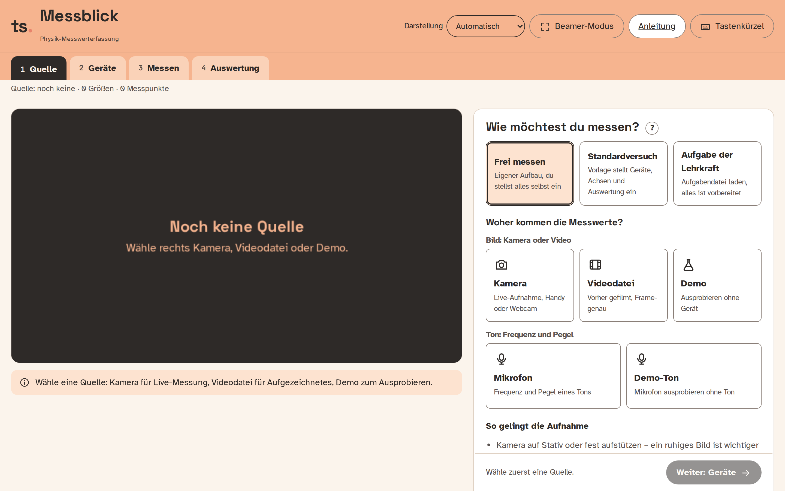
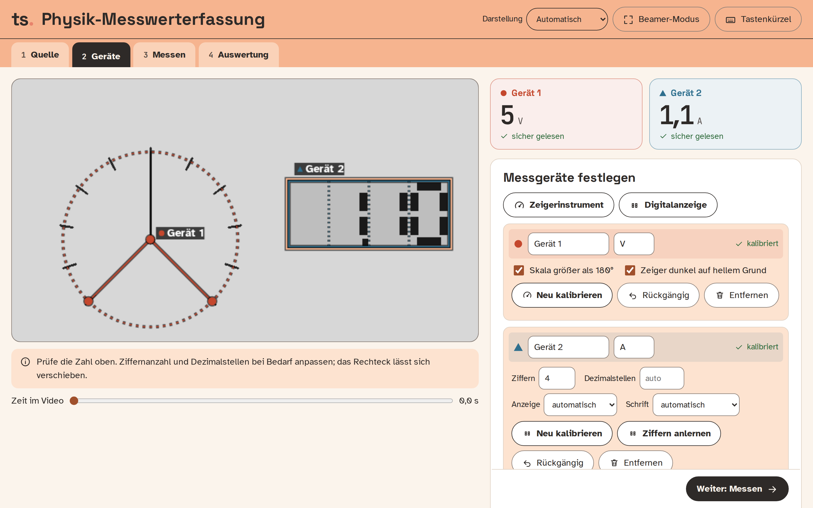
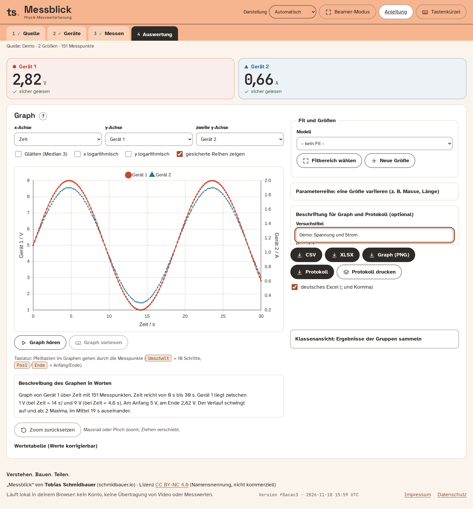
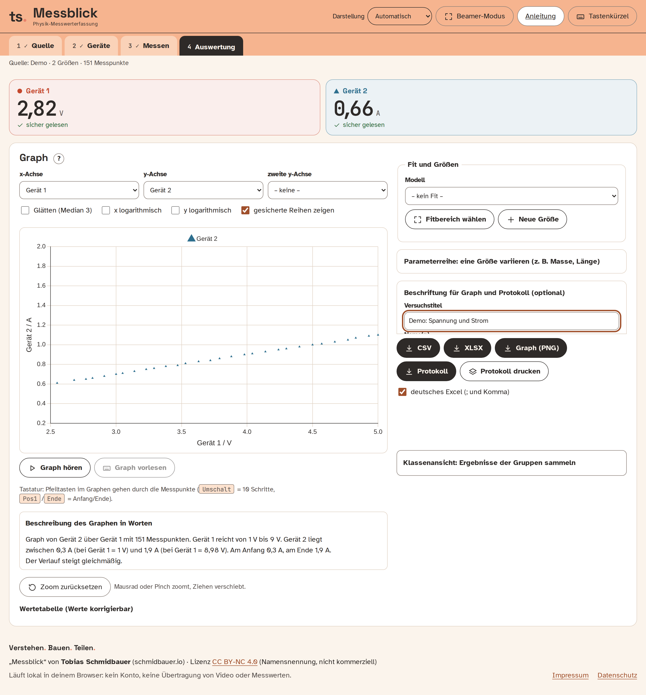
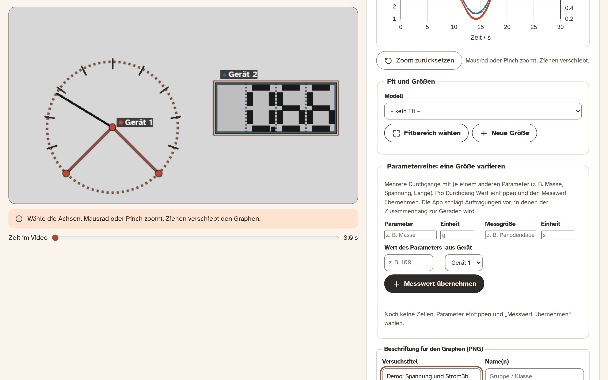
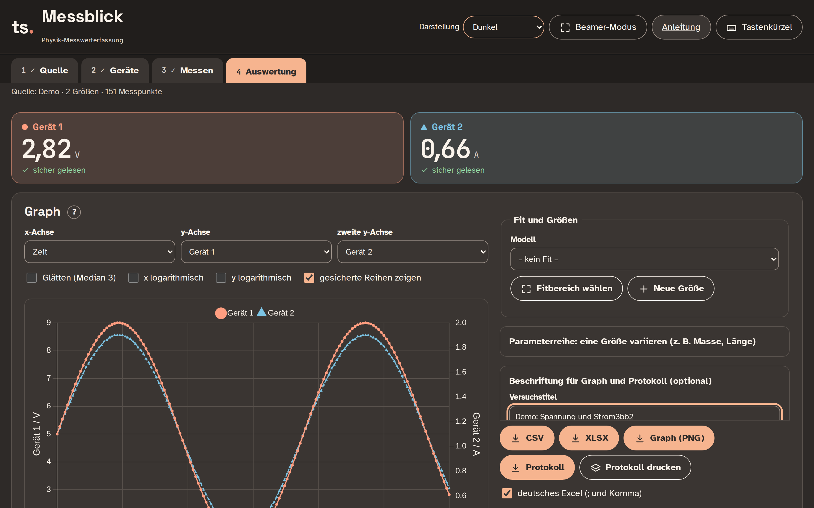
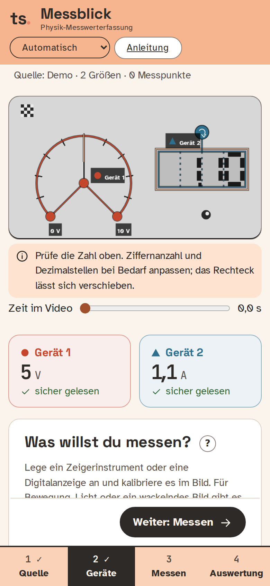

# Physik-Messwerterfassung

**Messgeräte im Physikunterricht abfilmen, Werte ablesen, Graph und Tabelle erhalten.**
Eine Webanwendung für Lehrkräfte und Schüler: Ein analoges Zeigerinstrument (z. B. PHYWE-Demogerät) oder eine Digitalanzeige (z. B. Multimeter) wird per Kamera oder Videodatei abgefilmt. Die App liest die Werte ab und erzeugt eine **CSV-/XLSX-Datei** sowie **Graphen** (Wert über Zeit oder über einem zweiten Messgerät).

Alles läuft **lokal im Browser**: kein Server, kein Konto, keine Übertragung von Video oder Messwerten, keine Schriften oder Skripte von fremden Servern.



## Funktionen
- **Quellen:** Kamera (live), Videodatei (Frame-genau, schneller als Echtzeit auswertbar) oder Demo zum Ausprobieren.
- **Zwei Gerätetypen, bis zu vier gleichzeitig:** Zeigerinstrument (Zeigerwinkel auf Skala abgebildet) und Digitalanzeige (7-Segment-Ziffern). Jedes Gerät hat eine feste Farbe und ein Symbol, in Bild, Live-Zahl, Graph und Tabelle.
- **Ziffern anlernen:** Liest die App eine LCD- oder Punktmatrix-Anzeige nur unsicher, tippt man einmal ein, was das Gerät gerade zeigt. Die App merkt sich diese Ziffern (nur lokal, in der Sitzung und in der Kalibrierdatei) und liest danach sicherer.
- **Geführte Kalibrierung:** Drehpunkt und zwei Skalenstriche anklicken bzw. Rechteck um die Ziffern ziehen. Punkte lassen sich ziehen oder mit Pfeiltasten verschieben, `Strg+Z` nimmt zurück. Die große Live-Zahl zeigt sofort, ob die Ablesung stimmt, Hinweise warnen bei Unschärfe, Spiegelung oder zu kleinem Gerät.
- **Messen:** Live aufnehmen (Leertaste) oder Video auswerten (abbrechbar). „Reihe sichern“ legt eine Messung beiseite, damit mehrere Reihen im Graphen verglichen werden können.
- **Auswertung:** Graph mit x = Zeit oder anderem Messgerät, zweite y-Achse, logarithmische Achsen, Zoom, Glättung, korrigierbare Wertetabelle.
- **Fit und Messunsicherheit:** Pro Gerät lässt sich die Messunsicherheit angeben (Güteklasse mit Messbereich, Ziffernschritte, fester Wert oder Zählrate √N). Der Graph zeigt dann Fehlerbalken, und der Fit wird damit gewichtet. Modelle: Gerade, Proportional, Zerfall mit Offset, Sättigung, Potenz, Sinus mit Offset, gedämpfter Sinus. Ergebnis mit Parametern ± σ (auf 2 gültige Stellen der Unsicherheit gerundet), R², χ²<sub>red</sub>, Fitkurve und Residuen. Der Fitbereich wird im Graphen per Ziehen gewählt.
- **Parameterreihe (eine Größe variieren):** Pro Durchgang den Parameter eintippen (z. B. Masse) und den Messwert aus der Live-Ablesung (Mittel über rund 2 s, mit Unsicherheit) oder einen Fitparameter übernehmen. Die App schlägt Auftragungen vor (y², 1/y, √y, ln y über x, x², 1/x …, gerankt nach R²), zeichnet sie mit Fit und exportiert die Reihe als CSV/XLSX.
- **Versuchsvorlagen:** In Schritt 1 wählbar: Kondensator laden und entladen, Spule (Ausschalten), Schwingkreis, Fotoeffekt (h), Planck-Konstante mit LEDs, Federpendel (D), Fadenpendel (g), Ohmsches Gesetz, radioaktiver Zerfall (T½), Abkühlkurve. Die Vorlage benennt die Geräte, stellt Achsen und Fitmodell ein, zeigt den Ablauf und rechnet die gesuchte Größe mit Unsicherheit aus. Eingaben wie R, L, C (mit optionaler Unsicherheit in %) fließen in die Fehlerfortpflanzung ein.
- **Literaturvergleich:** Jedes Ergebnis mit Literatur-, Nenn- oder Theoriewert (z. B. Thomson-Formel) wird beurteilt: „verträglich“ bis 2σ, sonst „nicht verträglich“ mit Hinweis auf mögliche systematische Fehler. Das Ergebnis steht im XLSX-Blatt „Ergebnis“. Die Themenbereiche der Vorlagen sind zur Orientierung genannt; die Zuordnung zu Jahrgangsstufe und LehrplanPLUS bitte vor dem Einsatz prüfen.
- **Unsicherheitsbudget:** Bei Vorlagen-Ergebnissen zeigt ein aufklappbares Budget, welche Eingabe (z. B. R, τ) wie viel der Gesamtunsicherheit ausmacht, und nennt, wo sich eine genauere Messung lohnt.
- **Bereichswechsel erkennen:** Springt ein Wert um genau eine Zehnerpotenz (Messbereichswechsel am Multimeter, Dezimalpunkt), warnt die App live am Gerät und markiert die Stelle in der Auswertung. Ein Klick rechnet die Werte ab dort um, ein weiterer nimmt es zurück.
- **Vorhersage:** In Schritt 3 zeichnen Schüler vor der Messung die erwartete Kurve (Maus oder Finger). In der Auswertung liegt sie gepunktet über der Messung, dazu eine Rückmeldung mit Denkanstoß statt einer Note.
- **Protokoll:** Eine druckfertige A4-Seite mit Gliederung (Fragestellung, Aufbau mit Kamerabild, Durchführung, Messwerte, Auswertung mit Graph, Fit und Vorlagen-Ergebnis, Fehlerbetrachtung, Fazit). Die Textfelder bleiben bewusst leer und lassen sich im Browser beschriften; danach drucken oder als PDF speichern. Die Datei ist eigenständig, ohne Skripte und ohne externe Inhalte.
- **Neue Größen:** Ableitung und Integral nach der Zeit sowie Formeln wie `Gerät_1*Gerät_2` (mit Fehlerfortpflanzung). Der Formelparser rechnet selbst und führt keinen Code aus.
- **Export:** CSV (deutsch mit `;` und Dezimalkomma oder international), XLSX (eine Tabelle pro Reihe), PNG-Graph mit Titel, Name und Datum.
- **Offline und installierbar:** Nach dem ersten Besuch ist die App ohne Netz nutzbar (Hinweis „Offline nutzbar“ in der Fußzeile) und lässt sich über das Browsermenü als App installieren. Gedacht für Physiksäle mit schwachem WLAN.
- **Unterricht:** Beamer-Modus (`B`), Darstellung Hell, Dunkel oder Hoher Kontrast, Handy-Layout mit Schritten in Daumenreichweite, Tastenkürzel (`?`), automatisches Speichern der Sitzung, Kalibrierung als Datei speichern und laden.

| Geräte kalibrieren | Auswertung mit zwei y-Achsen |
|---|---|
|  |  |

| Kanal über Kanal (z. B. U über I) | Beamer-Modus |
|---|---|
|  |  |

| Dunkle Darstellung | Auf dem Handy |
|---|---|
|  |  |

Alle Bilder stammen aus der laufenden App mit der eingebauten Demo-Quelle (synthetisches Zeigerinstrument und Digitalanzeige). Der Workflow `Screenshots aktualisieren` erzeugt sie bei Änderungen an der Oberfläche automatisch neu.

## Benutzung
Vier Schritte, oben als Register: **1 Quelle → 2 Geräte → 3 Messen → 4 Auswertung**.

1. **Quelle:** Kamera, Videodatei oder Demo wählen.
2. **Geräte:** Zeigerinstrument oder Digitalanzeige anlegen und kalibrieren. Beim Zeigerinstrument: Drehpunkt klicken, dann zwei Skalenstriche anklicken und den jeweiligen Wert im Dialog eingeben („Skala größer als 180°“ umschalten, falls nötig). Bei der Digitalanzeige: Rechteck eng um die Ziffern ziehen, Ziffernanzahl und ggf. Dezimalstellen einstellen.
3. **Messen:** Aufnahme starten oder Video auswerten.
4. **Auswertung:** Achsen wählen, Graph prüfen, exportieren.

## Auf GitHub Pages veröffentlichen
Der Workflow `.github/workflows/pages.yml` baut die Seite bei jedem Push auf `main` und veröffentlicht sie.
Einmalig im Repository: **Settings → Pages → Build and deployment → Source: „GitHub Actions“** wählen. Danach ist die App unter `https://<benutzer>.github.io/<repository>/` erreichbar. Die Kamera funktioniert dort, weil GitHub Pages HTTPS verwendet.

## Entwicklung
```bash
npm install
npm run dev               # Entwicklungsserver
npm test                  # Unit-Tests (Reader, Session, Export, Bildhinweise, Speicherung)
npm run build             # Produktionsbuild nach dist/
node tests/e2e-demo.mjs   # E2E mit Demo-Quelle (Dev-Server auf :5173 nötig, Playwright installiert); prüft u. a., dass keine externe Anfrage stattfindet
node tests/screenshots.mjs  # erzeugt die Bilder in docs/screenshots
npm run build && npx vite preview --port 4173 && node tests/e2e-offline.mjs   # Offline-Test: Neuladen ohne Netz, Demo liest weiter
```

Struktur: `src/readers` (Analog/Digital), `src/source` (Kamera/Datei/Demo), `src/session` (Daten), `src/export`, `src/ui` (Icons, Graph), `src/quality.ts` (Bildhinweise), `src/storage.ts` (Speichern), `src/sampler.ts`. Gestaltung: `PRODUCT.md`, `DESIGN.md`. Rechenlogik für Fit, Unsicherheit und abgeleitete Größen: `src/analysis`. Entwurf dazu: `docs/superpowers/specs/`.

## Grenzen
- Digital: 7-Segment-Anzeigen werden per Segmentabtastung gelesen. Für LCD (schwacher Kontrast, Schrägschrift, Lichtverlauf) und Punktmatrix-Anzeigen (5×7) gibt es den Zeichenvergleich, im Modus „automatisch“ als Rückfall. Er kennt eingebaute Vorlagen und lernt die Ziffern des eigenen Geräts an. Andere Schriften (Buchstaben, Sonderzeichen) liest er nicht; bei Punktmatrix zählt der Dezimalpunkt als eigene Zelle.
- Die Kamera sollte ruhig stehen (Stativ); die Kalibrierung gilt für einen festen Bildausschnitt.
- Beim Multimeter-Bereichswechsel warnt die App bei Sprüngen um Faktor 10, 100 oder 1000. Einheit und Dezimalstellen müssen weiter von Hand angepasst werden; Sprünge um andere Faktoren als Zehnerpotenzen erkennt sie nicht.
- Offline: Nach dem ersten Laden (einmal mit Netz) läuft die App ohne Netz, auch nach einem Neustart des Browsers. Neue Versionen kommen beim nächsten Laden mit Netz an. Die Kamera braucht weiterhin eine sichere Adresse (HTTPS oder localhost); Videodatei und Demo gehen immer.
- Bisher mit synthetischen Bildern und der Demo getestet, noch nicht an echten PHYWE-Geräten oder Multimetern.
