# Auswertung: zwei Videos eines Stromkreises (Zeigerinstrumente und Digitalmultimeter)

Stand: November 2026. Beide Videos stammen vom Handy der Lehrkraft, quer gefilmt. Es sind **zwei einzelne Aufnahmen**. Die Befunde gelten für diese Geräte und diese Aufnahmen; sie sind keine allgemeine Genauigkeitsangabe der App. Die Videos selbst liegen nicht im Repository, nur Standbilder (auf den Bildern ist nichts Persönliches zu sehen, außer Händen) und die exportierten Messreihen.

| Video | Inhalt | Dauer | Messreihe |
|---|---|---|---|
| `IMG_5909` | zwei Zeigerinstrumente (Typ „69-A“ bis 0,6 A / 3 A und „69-V“ bis 3 V / 15 V, beide Klasse 2,5), Lampe, Schieberegler 20 Ω, Hand | 7,8 s | [`zeiger-5909.csv`](zeiger-5909.csv) |
| `IMG_5908` | Digitalmultimeter FERREX, Spannungsanzeige fällt von etwa 14 V auf etwa 7,3 V | 7,6 s | [`multimeter-5908.csv`](multimeter-5908.csv) |

Die Auswertung läuft mit den Skripten `tools/auswertung-zeiger.mjs` und `tools/auswertung-multimeter.mjs` (Chromium, Vite-Server), also genau so, wie man die App von Hand bedient: Bild drehen, Geräte anlegen, kalibrieren, mit 30 Hz auswerten, CSV exportieren.

## 1. Zeigerinstrumente (Video IMG_5909)

### Wie das Messsystem angelegt wird

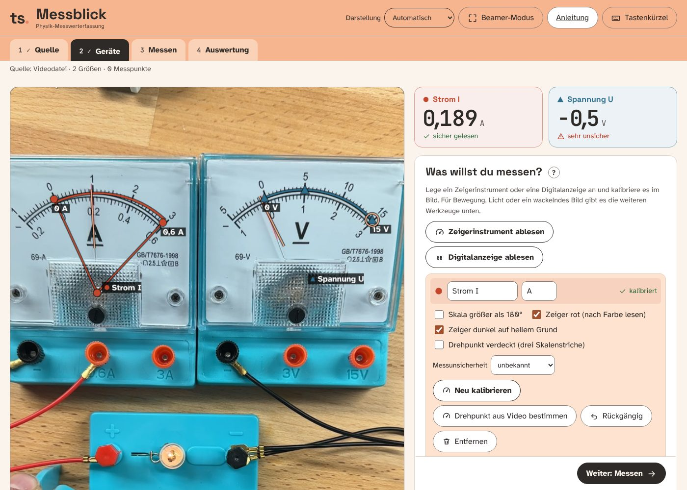

Die Instrumente liegen im Video quer; die App dreht das Bild mit „Bild nach links drehen“. Beide Geräte haben einen **verdeckten Drehpunkt** (die Nabe liegt hinter der Plexiglas-Linse). Deshalb: Anfang der Skala (0), Ende der Skala (0,6 A bzw. 15 V) und ein Skalenstrich in der Mitte am Skalenbogen anklicken; daraus rechnet die App den Drehpunkt. Die Zeiger sind **rot**; die App erkennt das und liest nach Farbe, weil sonst die schwarzen Buchstaben „A“ und „V“ auf dem Skalenblatt den Zeiger vortäuschen.

Der dicke Bogen im Bild liegt auf der aufgedruckten Skala, die beiden Skalenenden sind mit ihren Werten beschriftet. So prüft man, ob die Kalibrierung stimmt.

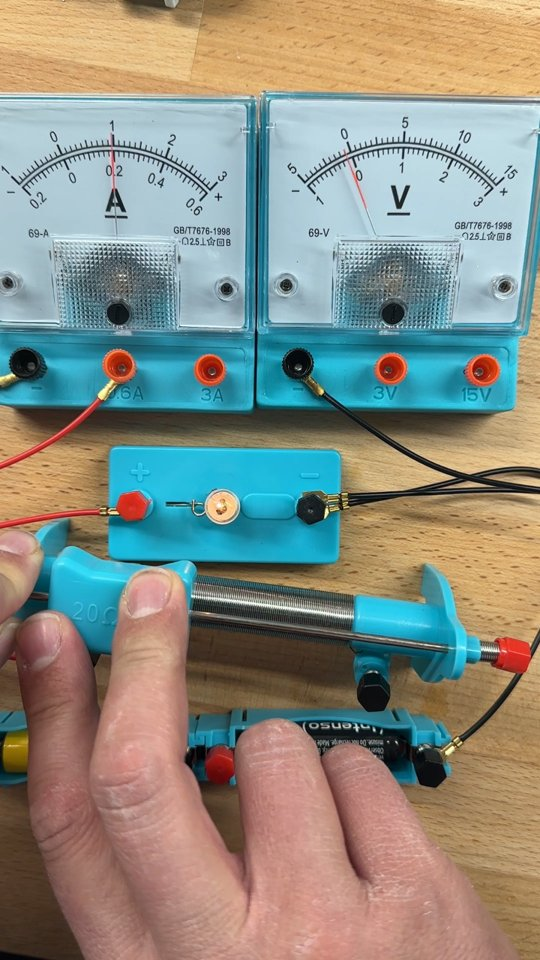

### So entsteht der Wert: Einzelbilder aus dem Video

Die Bilder sind Standbilder aus dem Video (um 90° gedreht), aufgenommen in der App zu den angegebenen Zeiten. Der dicke rote Bogen mit den Punkten „0 A“ und „0,6 A“ ist die Kalibrierung, der Punkt unten der aus dem Video bestimmte Drehpunkt. Die **blaue Linie** habe ich nachträglich aus dem angezeigten App-Wert zurückgerechnet und eingezeichnet (Drehpunkt, Winkel aus dem Wert); sie liegt auf dem roten Zeiger, so sieht man, dass der Wert zum Zeigerwinkel im Bild gehört. Die Zahl darunter ist die Live-Ablesung der App im jeweiligen Bild.

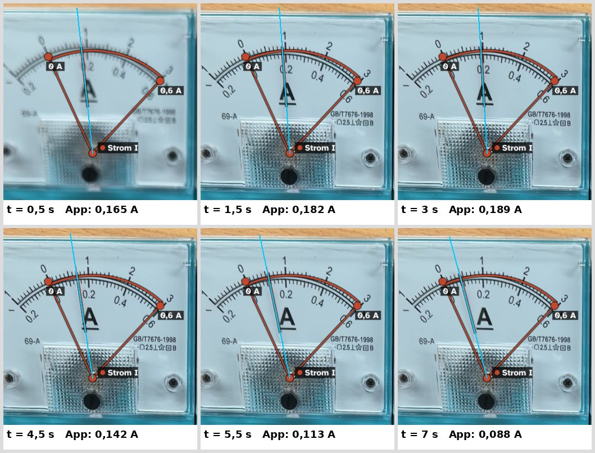

V-Meter: Der Zeiger steht in allen Bildern praktisch still, entsprechend bleibt die Ablesung bei −0,3 bis −0,5 V (blaue Linie wieder aus dem Wert zurückgerechnet).

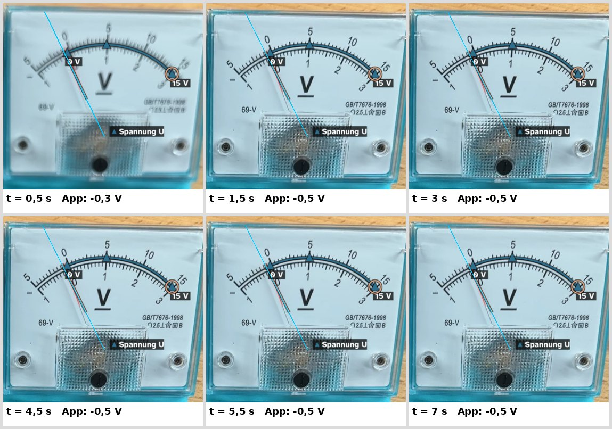

### Ergebnis Strom (A-Meter)

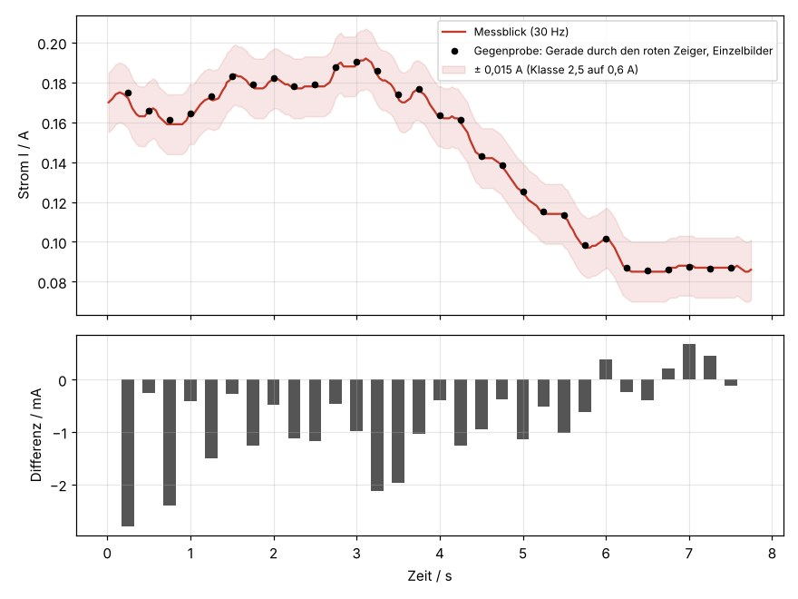

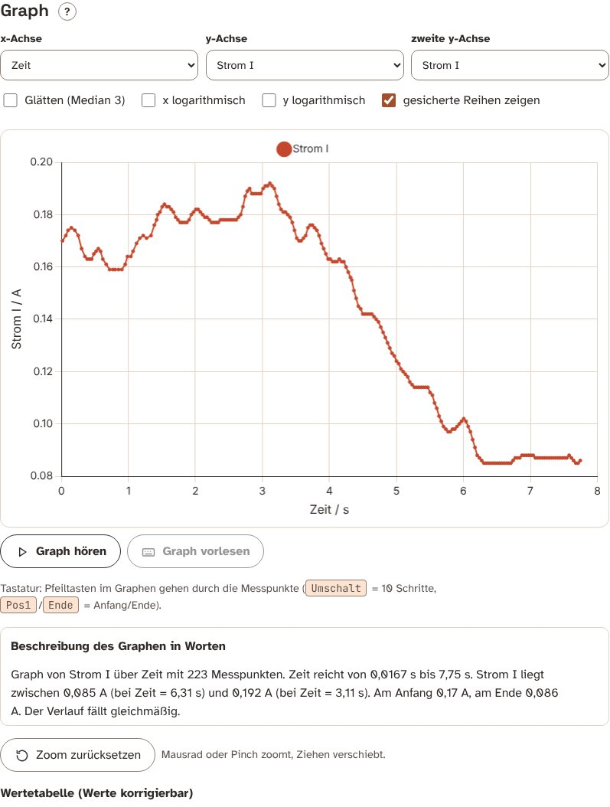

- Der Strom fällt von etwa 0,17 A (Maximum 0,19 A bei 3,1 s) auf 0,085 A bei 6,3 s. Die App liefert 223 Messpunkte in 7,7 s.
- **Gegenprobe:** In 30 Einzelbildern (alle 0,25 s) habe ich die rote Zeigerlinie unabhängig vom Ablese-Algorithmus der App angepasst (Gerade durch die roten Bildpunkte, Winkel um denselben Drehpunkt, dieselbe Skalenzuordnung). Differenz App minus Gegenprobe: Median −0,0006 A, mittlere Abweichung 0,0009 A, größte Abweichung 0,0028 A.
  **Grenze der Gegenprobe:** Sie prüft den Ablese-Algorithmus, nicht die Kalibrierung. Drehpunkt und Skalenstriche sind dieselben, ein Klickfehler dort steckt in beiden Reihen.
- **Drehpunkt aus dem Video:** Der Zeiger bewegt sich im Video über 12,2°. „Drehpunkt aus Video bestimmen“ legt eine Gerade durch den Zeiger in 39 Bildern und schneidet sie: Drehpunkt (159 | 377), mittlerer Abstand der Geraden vom Punkt 0,7 Bildpunkte. Eine frühere unabhängige Anpassung ergab (157,7 | 370,9). Der Unterschied liegt fast ganz in Zeigerrichtung und ändert den Winkel kaum.
- **Sichtprobe am Bild:** Bei 3,0 s steht der Zeiger auf dem Strich „1“ der 3-A-Skala, das sind 0,2 A. Die App liest 0,189 A, also 0,011 A weniger. Das liegt innerhalb der Klassengenauigkeit, ist aber ein Hinweis, dass die Kalibrierung selbst um etwa 0,01 A danebenliegen kann (siehe Fehlerliste).

### Ergebnis Spannung (V-Meter)

Der Zeiger des V-Meters bewegt sich im ganzen Video nur um 0,5°. Die App liest −0,3 bis −0,6 V (Median −0,5 V). Im Bild sieht man am V-Meter nur die Leitung zur „−“-Buchse, keine Leitung an „3 V“ oder „15 V“; das Instrument misst also vermutlich gar nichts, und der Zeiger steht nahe bei 0. Die −0,5 V sind dann eine Nullpunktabweichung, entweder der echten Nullstellung des Zeigers oder der Kalibrierung (siehe unten). Aus diesem Video lässt sich für die Spannung **keine Messkurve** ableiten. „Drehpunkt aus Video bestimmen“ lehnt das beim V-Meter richtig ab („Zeiger bewegt sich nur um 0,5°, nötig sind 3°“) und lässt die Kalibrierung aus den drei Skalenstrichen stehen.

### Fehler, Ungenauigkeiten und Toleranzen (Zeiger)

| Quelle | Größe | Anmerkung |
|---|---|---|
| **Klassengenauigkeit 2,5** (auf den Geräten aufgedruckt) | A-Meter: ±0,015 A (2,5 % von 0,6 A). V-Meter im 15-V-Bereich: ±0,375 V | gilt für das Gerät selbst, bezogen auf den Skalenendwert, nicht auf den Messwert. Bei 0,09 A sind ±0,015 A schon etwa 17 % des Messwerts. |
| **Ablesen des Zeigers** | etwa ±0,003 A beim A-Meter (Schätzung: eine halbe Skalenteilung) | die App kann feiner als der Mensch lesen, die Genauigkeit des Geräts wird dadurch nicht besser |
| **Klickfehler bei der Kalibrierung** | 1 Bildpunkt auf Skalenstrich 0 oder 0,6 A entspricht etwa 0,003 A, beim V-Meter etwa 0,07 V (aus Bogenradius und Skalenwinkel gerechnet) | 3 Bildpunkte Klickfehler wären beim A-Meter schon 0,008 A |
| **Drehpunkt aus drei Skalenstrichen** | Der Skalenbogen liegt bei diesen Geräten **nicht konzentrisch** zur Zeigerachse; der Drehpunkt aus drei Strichen lag 20 bis 40 Bildpunkte neben dem Drehpunkt aus den Zeigerlinien | Folge: systematische Fehler, die sich über die Skala ändern. Gegenmittel: „Drehpunkt aus Video bestimmen“, wenn der Zeiger sich bewegt. |
| **Parallaxe** | nicht gemessen | Zeiger und Skalenblatt liegen in verschiedenen Ebenen; Blickrichtung der Kamera schief zur Skala verschiebt die Ablesung. Hier wurde frontal von oben gefilmt, ein Restfehler ist möglich. |
| **Linse und Spiegelung** | nicht gemessen | Die Linse vor dem Zeigerende zeigt Spiegelungen; die rote Farberkennung ist dagegen unempfindlich, helle Spiegelungen fallen aber als Fehler an einzelnen Bildern auf. |
| **Verdeckung durch die Hand** | bei 0 s ist der A-Zeiger nicht lesbar | solche Bilder liefern keinen Wert; die Lücke steht im Graphen |
| **Zeitachse** | Bildabstand etwa 33 ms; Video hat variable Bildrate | Die App nimmt die echte Bildzeit; Zeitunsicherheit etwa ±17 ms (halber Bildabstand) |
| **Zeigerträgheit** | nicht gemessen | Drehspulinstrumente schwingen ein; die Kurve zeigt keine schnelle Dynamik. Das Wackeln der Kurve zwischen 0 und 3 s (0,16 bis 0,19 A) kann echt sein oder von der Bewegung der Hand kommen; aus dem Video allein ist das nicht zu trennen. |
| **Rundung** | die App gibt auf 0,001 A bzw. 0,1 V an | feiner als jede der oben genannten Fehlerquellen |

Wichtig für die Bewertung: Die Klassengenauigkeit (±0,015 A) ist **größer** als der Unterschied zwischen App und Gegenprobe (unter 0,003 A). Die App ist hier also nicht der begrenzende Faktor; es ist das Messgerät selbst plus die Kalibrierung.

### Was in der App dazugekommen ist (und was die Versuche gezeigt haben)

- **Bild drehen** (links/rechts), weil quer gefilmt wird.
- **Zeiger rot (nach Farbe lesen)**: wird beim Kalibrieren automatisch erkannt (rote, dünne, nicht waagrechte Linie im Zeigerbereich, auch in anderen Bildern des Videos, wenn eine Hand im aktuellen Bild stört). Ohne das las die App die schwarzen Buchstaben.
- **Drehpunkt aus Video bestimmen** (nur wenn sich der Zeiger über mindestens 3° bewegt; sonst klare Meldung).
- Beim neuen Drehpunkt bleibt die Entscheidung kleiner/größer als 180° erhalten (aus dem dritten Skalenstrich). Das war ein Fehler in der ersten Fassung: Die App las danach −0,04 A statt 0,19 A, weil sie den Bogen als „größer als 180°“ eingeschätzt hatte. Die Gegenprobe hat das aufgedeckt.

- Zusatz bei „automatisch“ (Digitalanzeige): Ist die Segmentabtastung bei sauberen 7-Segment-Ziffern ganz sicher (Vertrauen mindestens 0,95), gilt sie statt des Zeichenvergleichs. Der neue Zeichenvergleich verlor sonst bei der Demo-Anzeige Dezimalpunkte und Ziffern (z. B. 110 statt 1,18); der Test `tests/e2e-demo.mjs` hat das gezeigt. Am Multimeter-Video ändert das nichts (weiter 7 Fehlablesungen).

## 2. Digitalmultimeter (Video IMG_5908)

### Wie das Messsystem angelegt wird

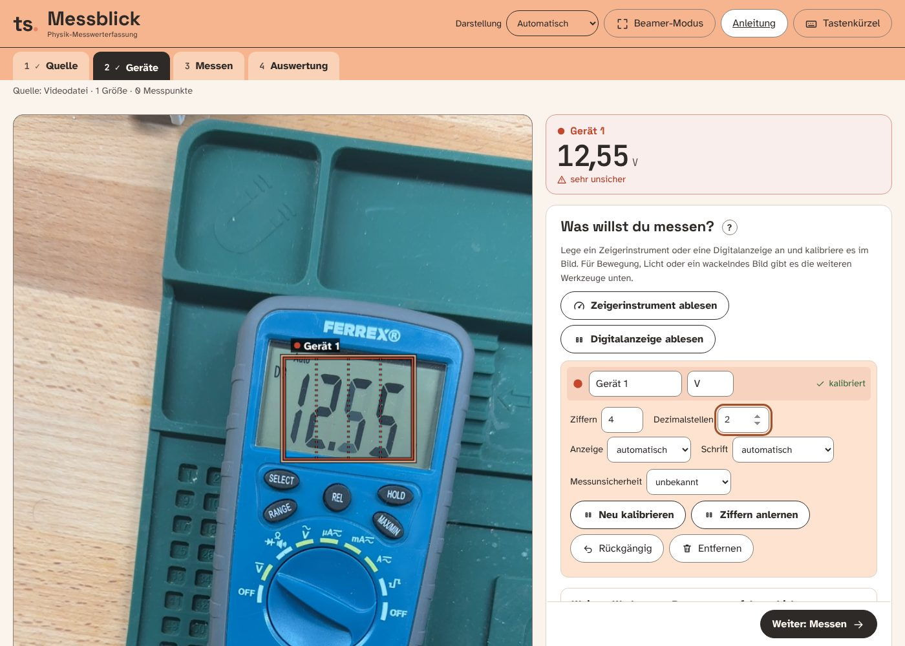

Bild nach links drehen, „Digitalanzeige ablesen“, Rechteck eng um die vier Ziffern ziehen, „Ziffern“ = 4, „Dezimalstellen“ = 2 (das Gerät zeigt immer zwei Nachkommastellen; ohne feste Angabe sah die App in einzelnen Bildern einen Punkt, wo keiner war). Die gestrichelten Linien im Rechteck zeigen die erkannten Ziffernzellen.

### So entsteht der Wert: Einzelbilder aus dem Video

Standbilder aus dem Video (um 90° gedreht) mit dem orangen Rechteck, das die App auswertet, den gestrichelten Ziffernzellen und der Ablesung der App darunter. Bei 2,54 s und 3,61 s steht zusätzlich, was ich selbst am Bild lese. Bei 2,54 s stimmt die App (ein schwaches Nachbild der alten Ziffer ist zu sehen). Bei 3,61 s liest sie 14,34 V statt 10,94 V: Die Ziffern sind im Rechteck nach rechts gerutscht, die letzte Ziffer sitzt am Zellrand.

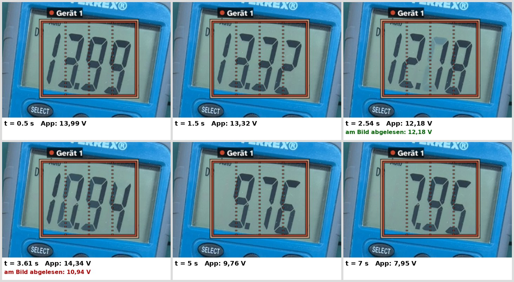

### Ergebnis

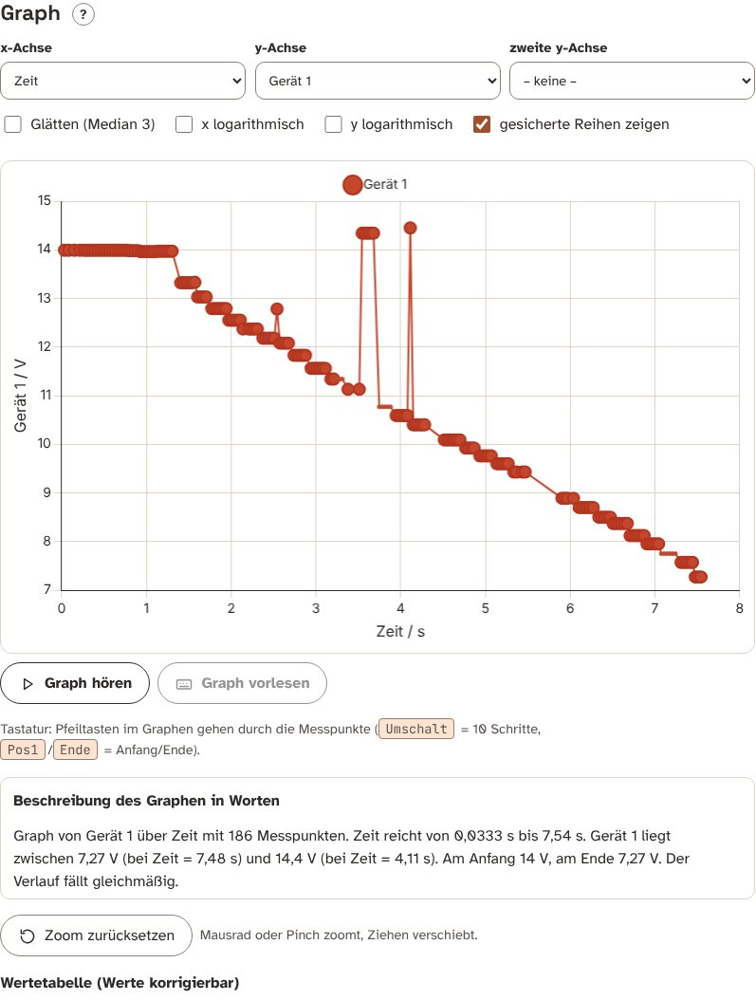

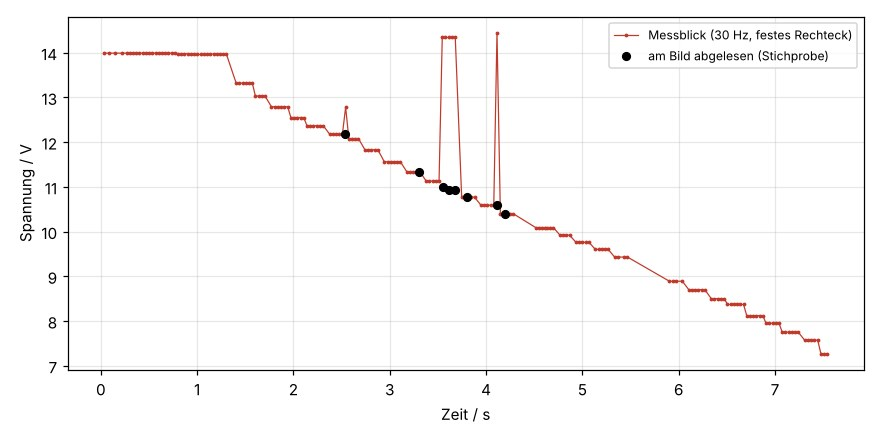

- 186 Messpunkte in 7,5 s (Bildabstand im Median 33 ms, größte Lücke 0,43 s, dort wurde nichts Sicheres gelesen). Die Spannung fällt von 13,99 V auf 7,27 V.
- Die Werte folgen der Anzeige. 8 Stichproben, am Bild von mir abgelesen (der Wert „abgelesen“ ist meine Sicht auf das Standbild, keine unabhängige Messung): 5 stimmen auf 0,01 V überein, 3 sind falsch.
- **7 von 186 Werten (3,8 %) sind Fehlablesungen:** 12,78 V statt 12,18 V (2,54 s), 14,34 V statt etwa 10,94 V (fünf Bilder von 3,55 bis 3,68 s) und 14,45 V statt 10,59 V (4,11 s). Sie sind als Spitzen im Graphen sichtbar. Der größte Fehler ist +3,9 V.

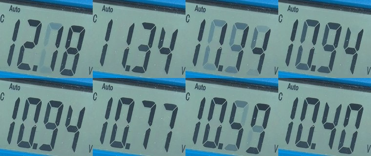

  Auf den Bildern sieht man zwei Ursachen: Bei 3,55 s und 4,11 s ist die Anzeige gerade am Umschalten, die alten Ziffern stehen als schwache „Geisterziffern“ (LCD-Nachbild) noch halb da. Bei 3,61 s und 3,68 s ist die Anzeige sauber, trotzdem liest die App falsch; dort sind die Ziffern im Bild leicht verrutscht (Handkamera), und die Ziffernzellen im festen Rechteck passen nicht mehr genau. Das Letzte ist eine Vermutung aus dem Standbild, ich habe es nicht einzeln überprüft.
- Frühere Tests mit einem gut gesetzten Rechteck: In 11 von 11 klaren Bildern las die App richtig. **Das Ergebnis hängt also stark am Rechteck** und am ruhigen Bild.

### Fehler, Ungenauigkeiten und Toleranzen (Digital)

| Quelle | Größe | Anmerkung |
|---|---|---|
| **Auflösung der Anzeige** | 0,01 V | letzte Stelle springt; ±1 Stelle ist Anzeigeunschärfe |
| **Gerätegenauigkeit** | im Video nicht bekannt | Das Datenblatt des FERREX-Geräts liegt nicht vor. Handmultimeter dieser Klasse haben typischerweise einen Fehler im Bereich von ±(0,5 bis 1,5 % + einige Stellen); das ist eine Annahme, keine Angabe des Geräts. |
| **LCD-Nachbilder** | 3,8 % der Werte falsch (Summe aller Fehlablesungen) | Frames während des Umschaltens; die App erkennt sie nicht sicher. Ein Median-Filter über 3 Werte (Schalter „Glätten“) entfernt einzelne Ausreißer, nicht aber fünf gleiche in Folge. |
| **Rechteck um die Ziffern** | Fehlablesungen schon bei wenigen Bildpunkten Versatz | feste Position, Handkamera schiebt die Anzeige im Bild. Mit Stativ weniger Fehler. Die Werkzeuge „Kamera-Wackeln ausgleichen“ (Bildanker) wurden in diesem Versuch nicht benutzt; sie könnten helfen, getestet ist das hier nicht. |
| **Schräg stehende Ziffern** (Kursivschrift des LCD) | wird ausgeglichen | Die App richtet die Ziffern gerade; bei sehr schräger Aufnahme bleibt ein Fehlerrisiko |
| **Zeitachse** | etwa ±17 ms | wie oben |
| **Änderungsrate** | bis 1,4 V/s, bei 33 ms Bildabstand etwa 0,05 V zwischen zwei Bildern | die Anzeige des Multimeters selbst aktualisiert langsamer (etwa 2 bis 3 Mal pro Sekunde); viele Messpunkte haben deshalb gleiche Werte (Treppenstufen im Graphen) |
| **Messbereich** | Bereichswechsel würde Sprünge um den Faktor 10 geben | im Video nicht aufgetreten |

## 3. Was daraus für die Benutzung folgt

1. Zeigerinstrument mit **verdecktem Drehpunkt**: drei Skalenstriche am Skalenbogen klicken; bewegt sich der Zeiger über mehr als 3°, danach „Drehpunkt aus Video bestimmen“.
2. **Roter Zeiger** wird erkannt; bei schwarzen Zeigern auf Schrift und Skalenstriche achten.
3. Immer eine **Gegenprobe am Standbild**: Zeiger bei einem Bild von Hand ablesen und mit der App vergleichen; Unterschiede in der Größe der Klassengenauigkeit sind normal.
4. Digitalanzeige: **Rechteck eng, Kamera ruhig (Stativ)**, Ziffern und Dezimalstellen festlegen, bei Spitzen im Graphen „Glätten (Median 3)“ und die Werte in der Tabelle prüfen. Spitzen, die mehrere Bilder lang stehen, bleiben stehen und müssen von Hand korrigiert werden (die Wertetabelle ist korrigierbar).
5. Die angegebene Messunsicherheit der App sollte mit der Klassengenauigkeit (Zeiger) bzw. dem Datenblatt (Digital) gesetzt werden.

## 4. Grenzen dieser Auswertung

- Die Abtastung während der Wiedergabe trifft bei jedem Lauf etwas andere Bildzeitpunkte; zwei Läufe unterscheiden sich in einzelnen Zeilen (und in der Zahl der Lücken ohne Wert). Die Aussagen oben gelten für den hier abgelegten Lauf.
- Zwei Videos, je ein Gerät; keine Statistik über viele Geräte.
- Die „wahre“ Zeigerstellung ist meine Anpassung einer roten Linie im Standbild beziehungsweise meine Sichtablesung. Das ist keine Messung mit einem übergeordneten Normal.
- Der Spannungszeiger bewegt sich nicht, die Spannungskurve des Zeigers ist damit nicht überprüft. Für den Messbereich des V-Meters (3 V oder 15 V) ist im Video keine Buchse belegt; ich habe die 15-V-Skala angesetzt.
- Parallaxe, Zeigerträgheit und die Gerätetoleranz des Digitalmultimeters sind nicht gemessen.
- Die Kamera läuft in einem Browser-Test mit Chromium; ein anderer Browser decodiert das Video leicht anders (Farben, Bildzeiten).
- Echte Kamera- oder Mikrofonaufnahmen im Live-Betrieb wurden nicht getestet, nur Videodateien.
